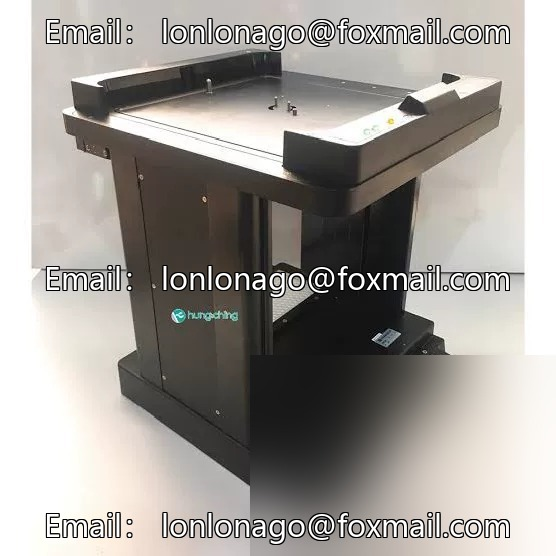
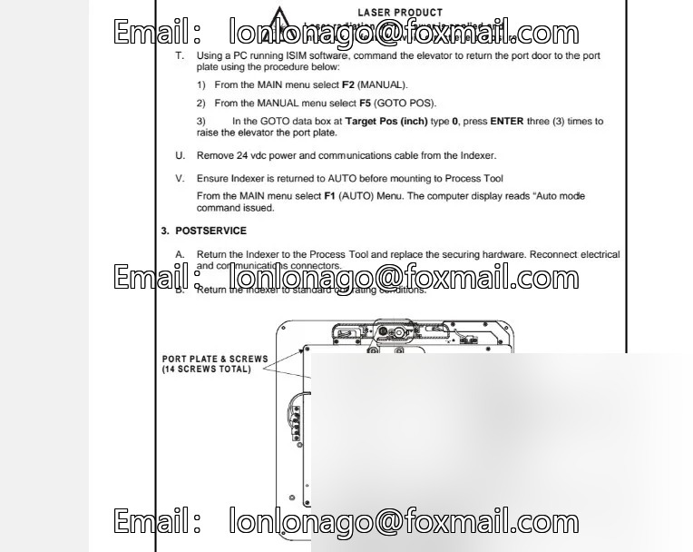
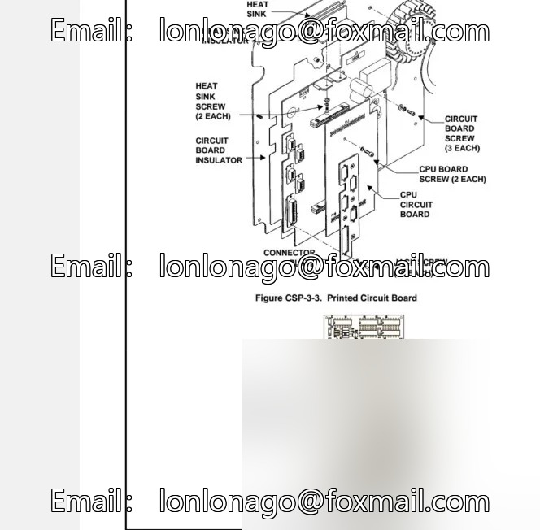
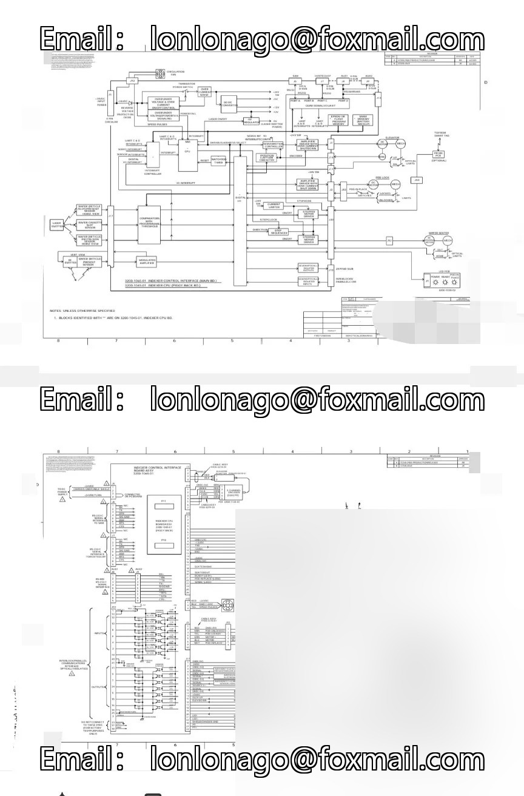
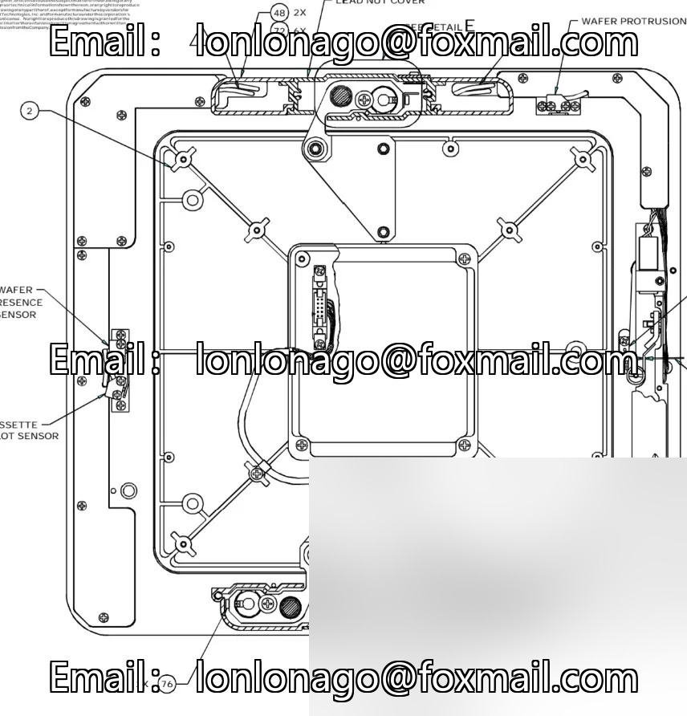
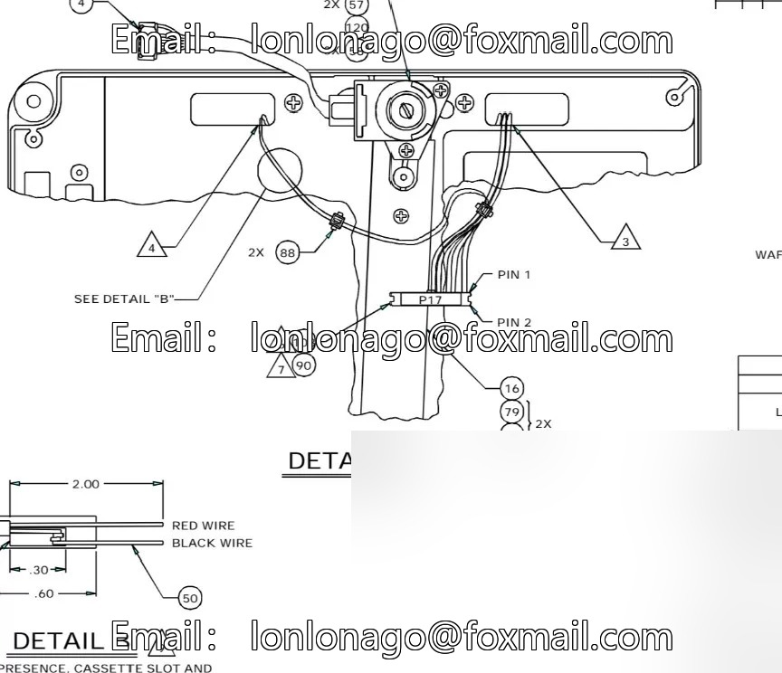
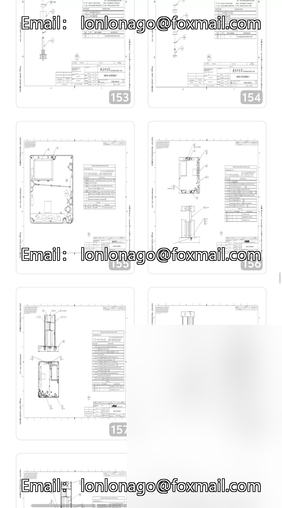

# Asyst Technologies (now acquired by KLA)

## Body

The SMIF-Indexer™ series technical manual of Asyst Technologies (currently acquired by KLA).
PDF 280 pages
335971
Chapter 1 - GENERAL INFORMATION: safety specifications (laser safety, electrical and other), equipment identification, terminology.

Chapter 2 - THEORY OF OPERATION: Equipment overview, index sequence, mechanical/electonic principles (motor control, sensors, communication interfaces such as SECS/GEM, etc.)

Chapter 3 - DIAGNOSTICS AND TROUBLESHOOTING: ISM software diagnostics, problem identification, self-checking, error types and information.

Chapter 4 - SERVICE: Safety requirements, lubrication, preventive maintenance, calibration/alignment (laser, water level, door latches, etc.), corrective service (replacement of encoder, motor, lock, etc.).

APPENDICES: spare parts list, electrical/mechanical drawings, indexer simulator software, communication software (SECS) guidelines.

ILLUSTRATIONS: Large-scale equipment structure, component breakdowns, and optical path/current flow diagrams.

Application scenarios: Mainly used in semiconductor cleanrooms to achieve automatic connection, lifting and wafer transfer between wafer boxes (Pod) and process equipment, ensuring micro-environment isolation of the production line and preventing wafer contamination.

Series positioning: INX 2150 and INX 2200 are the specific models of this series, and the manual covers calibration, maintenance, fault troubleshooting, and electrical mechanical drawings.

The manual covers Asyst Technologies (acquired by KLA) SMIF-Indexer™ technology, including safety requirements, operation theory, diagnostics, troubleshooting, service, appendices and illustration applications.

<!-- AI_ENRICHED -->

## Images

## Payment

Here is a pay link on Stripe ( https://buy.stripe.com/3cs8yP7sY87d0vu9AB ). Please contact me lonlonago@foxmail.com after funding $89, and I will send you a complete data files , thank you!

